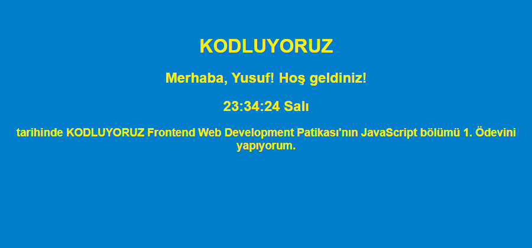

# 🕒 JavaScript Canlı Saat ve Karşılama Ekranı

Bu proje, Patika.dev'in Frontend Web Development Patikası'nda yer alan JavaScript bölümü 1. Ödevini tamamlamak amacıyla geliştirilmiştir. Proje, Vanilla JavaScript (saf JS) kullanarak **DOM Manipülasyonu** ve **Zaman Fonksiyonları**nı pratik etmeyi amaçlamaktadır.

## 🌟 Proje Özellikleri

* **Kullanıcı Karşılama:** Sayfa açılışında kullanıcıdan adını ister ve alınan isimle kişiselleştirilmiş bir karşılama metni sunar.
* **Canlı Saat:** Mevcut saat, dakika ve saniye bilgisini, `setInterval()` metodu sayesinde **anlık olarak günceller.**
* **Haftanın Günü:** Saatin yanında haftanın gününü (Örn: Cuma) dinamik olarak gösterir.
* **Versiyon Kontrolü:** Projenin son aşaması olarak Git ve GitHub kullanımı pratik edilmiştir.

## 🛠️ Kullanılan Teknolojiler

* HTML5
* CSS3
* Vanilla JavaScript (ES6+)

## ✨ Temel JS Taktikleri

Bu projede kullanılan ve pekiştirilen temel JavaScript metotları şunlardır:

* `prompt()`: Kullanıcıdan veri almak.
* `document.getElementById()` ve `.innerHTML`: DOM elementlerine erişim ve içeriği güncelleme.
* `new Date()`: Anlık zaman, tarih ve gün bilgilerini almak.
* `setInterval()`: Saati her saniye güncellemek için zamanlayıcı kurmak.
* Diziler (Arrays): Gelen sayısal gün değerlerini (0'dan 6'ya) metin karşılıklarına çevirmek.

## ▶️ Çalıştırma

Derleme veya sunucu gerekmez. Repoyu indirip `index.html` dosyasını tarayıcıda açın. Sayfa açılışta adınızı sorar, boş bırakırsanız "Ziyaretçi" yazar.

## 📁 Dosyalar

| Dosya | Görev |
|---|---|
| `index.html` | Sayfa iskeleti ve stiller |
| `script.js` | Karşılama metni ve canlı saat |
